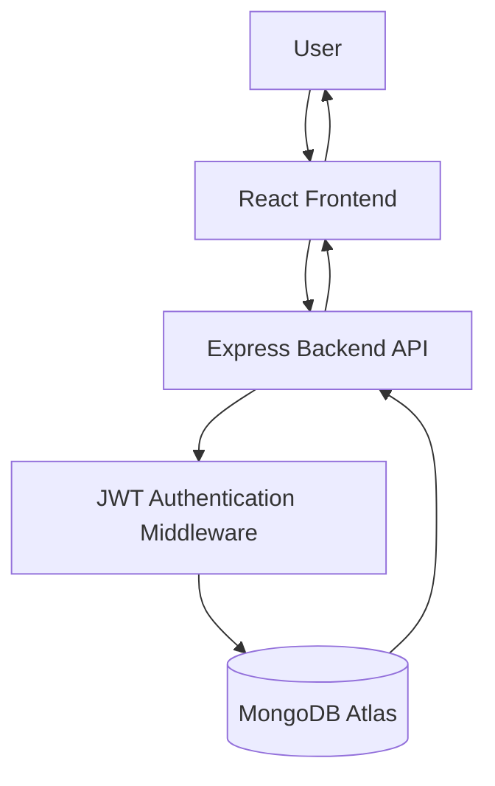
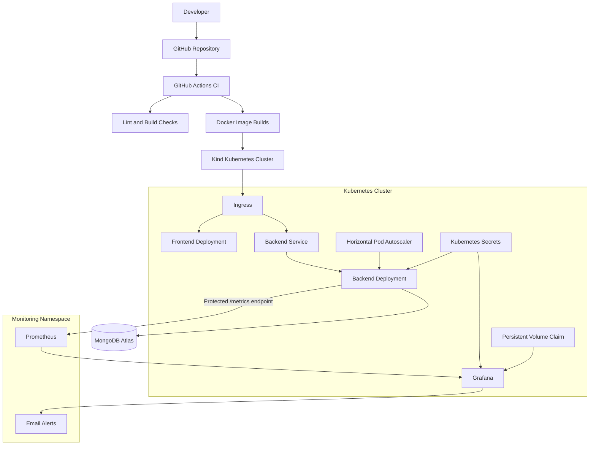
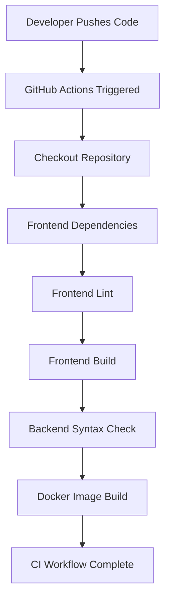

# 🚀 DevOps Task Manager

### A Full-Stack Task Management Application with Authentication, Containerization, Kubernetes Orchestration, and Monitoring

[](https://react.dev/)
[](https://nodejs.org/)
[](https://expressjs.com/)
[](https://www.mongodb.com/)
[](https://www.docker.com/)
[](https://kubernetes.io/)
[](https://prometheus.io/)
[](https://grafana.com/)

---

## 📌 Project Overview

**DevOps Task Manager** is a full-stack task management application developed to demonstrate the integration of modern web development and DevOps practices.

The application allows users to register, log in, and manage their personal tasks securely. Each user can create, view, update, and delete tasks without accessing another user's data.

Beyond application development, the project focuses on containerization, Kubernetes orchestration, application security, automated CI checks, and infrastructure monitoring.

The application uses Docker to package services, Kubernetes to manage deployments, and Prometheus and Grafana to monitor application performance and generate email alerts.

### 🎯 Problem Statement

Traditional task management applications may lack proper user isolation, deployment automation, container orchestration, and infrastructure monitoring.

This project addresses these challenges by combining:

- Secure user authentication and authorization.
- User-specific task management.
- Containerized application deployment.
- Kubernetes-based orchestration and scaling.
- Centralized application monitoring.
- Automated build and validation workflows.

---

## ✨ Key Features

### 1. Task Management

- Create new tasks.
- View existing tasks.
- Update task information.
- Delete tasks.
- Maintain individual task ownership.

### 2. Authentication and Security

- User registration and login.
- JWT-based authentication.
- Password hashing using bcrypt.
- Protected backend routes.
- Middleware-based token verification.
- User-specific task access.
- Kubernetes Secrets for sensitive configuration.
- Basic Authentication for protected Prometheus metrics.

### 3. Containerization

- Dockerized frontend and backend.
- Multi-stage frontend Docker build.
- Docker Compose for local multi-container execution.
- Consistent application environments.

### 4. Kubernetes Orchestration

- Deployments and Services.
- ConfigMaps and Secrets.
- Ingress configuration.
- Horizontal Pod Autoscaler (HPA).
- Readiness and liveness probes.
- CPU and memory resource requests and limits.
- Role-Based Access Control (RBAC).
- Persistent Volumes and Persistent Volume Claims.
- StatefulSets.
- Jobs and CronJobs.
- Network Policies.
- Kustomize base and environment overlays.

### 5. Monitoring and Alerting

- Prometheus for application metrics collection.
- Grafana for monitoring dashboards.
- Node.js heap memory monitoring.
- Backend CPU usage monitoring.
- Backend memory monitoring.
- Grafana persistent storage.
- Email notifications through SMTP.
- Alert rules for backend memory usage.

### 6. CI Pipeline

GitHub Actions automates:

- Frontend linting and build validation.
- Backend syntax checking.
- Docker image builds.

The current workflow performs CI validation and image builds; it does not automatically push images or deploy to Kubernetes.

---

## 🏗️ System Architecture

The application follows a frontend-backend architecture with a separate monitoring stack.

### Application Architecture



### DevOps Architecture



### Application Flow

1. The user interacts with the React frontend.
2. The frontend sends API requests to the Express backend.
3. Authentication middleware verifies the JWT token.
4. The backend processes authorized requests.
5. MongoDB Atlas stores user and task information.
6. Prometheus collects protected backend metrics.
7. Grafana visualizes metrics and evaluates alert rules.
8. Email notifications are sent when configured alert conditions are met.

---

## 🛠️ Technology Stack

| Category | Technologies |
|---|---|
| Frontend | React, JavaScript, CSS |
| Backend | Node.js, Express.js |
| Database | MongoDB Atlas |
| Authentication | JWT, bcrypt |
| API | REST API |
| Containerization | Docker, Docker Compose |
| Orchestration | Kubernetes, Kind |
| Configuration | ConfigMaps, Secrets |
| Scaling | Kubernetes HPA |
| Deployment Management | Kustomize |
| Monitoring | Prometheus |
| Visualization | Grafana |
| CI | GitHub Actions |
| Infrastructure Exercise | Terraform |

---

## 📂 Project Structure

```text
devops-task-manager/
│
├── backend/
│   ├── middleware/
│   │   └── authMiddleware.js
│   │
│   ├── models/
│   │   ├── Task.js
│   │   └── User.js
│   │
│   ├── routes/
│   │   └── authRoutes.js
│   │
│   ├── server.js
│   ├── package.json
│   └── package-lock.json
│
├── frontend/
│   ├── src/
│   │   ├── components/
│   │   │   ├── Auth.jsx
│   │   │   └── Navbar.jsx
│   │   │
│   │   ├── services/
│   │   │   ├── authService.js
│   │   │   └── taskService.js
│   │   │
│   │   ├── App.jsx
│   │   └── App.css
│   │
│   └── package.json
│
├── k8s/
│   ├── grafana.yaml
│   ├── grafana-pvc.yaml
│   ├── prometheus.yaml
│   ├── prometheus-config.yaml
│   └── ...
│
├── .github/
│   └── workflows/
│       └── ...
│
├── docker-compose.yml
├── .gitignore
└── README.md
```

*Note: The structure above highlights the main project components. Other Kubernetes manifests, Dockerfiles, and Kustomize files are maintained in their respective project directories.*

---

## 🔐 Authentication and Security

Security is an important part of this project.

### JWT Authentication

- Users authenticate using their login credentials.
- The backend generates JWT tokens after successful authentication.
- Protected routes validate the token using authentication middleware.
- Unauthorized requests are rejected.

### Password Security

Passwords are hashed using bcrypt before being stored in MongoDB.

Plain-text passwords are not stored in the database.

### User Data Isolation

Each task is associated with its owner. Backend authorization ensures users can only access their own tasks.

### Kubernetes Secrets

Sensitive application configuration is stored in Kubernetes Secrets rather than hardcoded in deployment manifests.

Examples include:

- MongoDB connection URI.
- JWT secret.
- Grafana administrator credentials.
- SMTP credentials.
- Prometheus metrics authentication credentials.

**Security note:** Kubernetes Secrets should be protected with appropriate RBAC permissions and encryption at rest. Do not commit actual Secret values or `.env` files to GitHub.

---

## 🐳 Docker and Containerization

Docker is used to package the frontend and backend into separate containers.

### Key Implementations

- Separate frontend and backend Dockerfiles.
- Multi-stage frontend build.
- Docker Compose for local application orchestration.
- Containerized deployment with consistent environments.

### Run with Docker Compose

Make sure Docker Desktop is running.

From the project root:

```bash
docker compose up --build
```

To run in detached mode:

```bash
docker compose up --build -d
```

To stop the containers:

```bash
docker compose down
```

*The exact service URLs and environment variables depend on the Docker Compose configuration.*

---

## ☸️ Kubernetes Deployment

The application is deployed locally using Kubernetes through Kind.

### Kubernetes Features Implemented

| Kubernetes Resource | Purpose |
|---|---|
| Deployment | Manages application pods |
| Service | Enables internal communication |
| Ingress | Routes incoming traffic |
| ConfigMap | Stores non-sensitive configuration |
| Secret | Stores sensitive configuration |
| HPA | Automatically scales application pods |
| PVC/PV | Provides persistent storage |
| StatefulSet | Manages stateful workloads |
| Job | Runs one-time tasks |
| CronJob | Schedules recurring tasks |
| RBAC | Controls resource permissions |
| NetworkPolicy | Controls pod-to-pod network traffic |

### Check Cluster Status

```bash
kubectl cluster-info
```

```bash
kubectl get nodes
```

### Check Application Pods

```bash
kubectl get pods
```

### Check Services

```bash
kubectl get services
```

### Check Deployments

```bash
kubectl get deployments
```

### Check Horizontal Pod Autoscaler

```bash
kubectl get hpa
```

### Check Monitoring Resources

```bash
kubectl get pods -n monitoring
```

### Access Grafana Locally

```bash
kubectl port-forward -n monitoring service/grafana-service 3000:3000
```

Open:

```text
http://localhost:3000
```

### Access Prometheus Locally

```bash
kubectl port-forward -n monitoring service/prometheus-service 9090:9090
```

Open:

```text
http://localhost:9090
```

---

## 📊 Monitoring with Prometheus and Grafana

Prometheus collects backend application metrics, while Grafana provides dashboards and alerting.

### Prometheus

The backend exposes a protected `/metrics` endpoint.

Prometheus authenticates with Basic Authentication using credentials mounted from a Kubernetes Secret.

### Grafana Dashboard

The project includes a dashboard named:

**Task Manager Monitoring Dashboard**

It contains three monitoring panels:

| Panel | Metric | Purpose |
|---|---|---|
| Node.js Heap Memory | `nodejs_heap_size_used_bytes` | Tracks Node.js heap memory usage |
| Backend CPU Usage | `rate(process_cpu_seconds_total[5m]) * 100` | Tracks backend CPU usage |
| Backend Memory Usage | `process_resident_memory_bytes / 1024 / 1024` | Tracks backend resident memory in MiB |

### Alerting

An alert rule named `Backend Memory Usage` monitors backend memory consumption.

- Configured threshold: Greater than 250 MiB.
- Evaluation interval: 1 minute.
- Pending period: 1 minute.
- Notification contact point: `Task Manager Notifications`.
- Notification channel: Email through SMTP.

Grafana uses a PersistentVolumeClaim to preserve its database and configuration across pod restarts.

---

## ⚙️ Local Installation and Setup

### Prerequisites

Install the following tools:

- Node.js and npm.
- Git.
- MongoDB Atlas account or a compatible MongoDB database.
- Docker Desktop.
- Kubernetes CLI (`kubectl`).
- Kind.
- Terraform (for the local Terraform exercise).

### 1. Clone the Repository

```bash
git clone https://github.com/SouravKumar911/devops-task-manager.git
```

```bash
cd devops-task-manager
```

### 2. Backend Setup

Navigate to the backend:

```bash
cd backend
```

Install dependencies:

```bash
npm install
```

Create a `.env` file in the backend directory.

Configure the required environment variables:

```env
PORT=5000
MONGO_URI=your_mongodb_connection_string
JWT_SECRET=your_secure_random_secret
METRICS_USERNAME=your_metrics_username
METRICS_PASSWORD=your_metrics_password
```

Replace the placeholder values with your own configuration.

Start the backend:

```bash
node server.js
```

### 3. Frontend Setup

Open another terminal:

```bash
cd frontend
```

Install dependencies:

```bash
npm install
```

Start the development server:

```bash
npm run dev
```

The frontend normally runs at:

```text
http://localhost:5173
```

The backend runs on the configured port, normally:

```text
http://localhost:5000
```

Make sure the frontend API configuration points to the correct backend address.

---

## 🔄 CI Pipeline with GitHub Actions

GitHub Actions is used to automate validation and Docker image builds whenever changes are pushed or a pull request triggers the configured workflow.

### Current CI Responsibilities

1. Checkout repository.
2. Install frontend dependencies.
3. Run frontend lint checks.
4. Build the frontend.
5. Check backend JavaScript syntax.
6. Build Docker images.

### CI Workflow



**Note:** The current pipeline performs continuous integration checks. Automated image publishing and Kubernetes deployment are not currently configured.

---

## 🧪 Testing and Verification

The project can be verified through the following checks:

### Application

- Register a new user.
- Log in with valid credentials.
- Verify unauthorized access is rejected.
- Create, update, and delete tasks.
- Verify users cannot access another user's tasks.

### Docker

```bash
docker compose ps
```

### Kubernetes

```bash
kubectl get pods
kubectl get services
kubectl get deployments
kubectl get hpa
```

### Monitoring

- Check Prometheus targets.
- Verify backend metrics scraping.
- Open the Grafana dashboard.
- Verify all three monitoring panels.
- Test the email notification contact point.
- Restart Grafana and verify that the dashboard and alert configuration persist.

---

## 🛣️ Future Improvements

Potential improvements for future development include:

- Deploy the application to a cloud platform.
- Implement automated CD with GitHub Actions.
- Push Docker images to a container registry.
- Add automated unit and integration testing.
- Add centralized application logging.
- Implement HTTPS and production-grade ingress configuration.
- Add Kubernetes Secret encryption at rest.
- Implement database backup and recovery automation.
- Add more Grafana dashboards and alert rules.

---

## 🎓 Learning Outcomes

This project provided practical experience in:

- Full-stack application development.
- REST API development.
- JWT authentication and authorization.
- MongoDB database integration.
- Docker containerization.
- Kubernetes orchestration.
- Kubernetes security and resource management.
- Application monitoring with Prometheus.
- Dashboard creation and alerting with Grafana.
- Git and GitHub workflows.
- CI automation using GitHub Actions.
- Infrastructure-as-Code fundamentals using Terraform.

---

## 👨‍💻 Author

**Sourav Kumar**

BE – Information Technology

Thakur College of Engineering and Technology, Mumbai

### Connect With Me

- **GitHub:** [SouravKumar911](https://github.com/SouravKumar911)
- **Project Repository:** [DevOps Task Manager](https://github.com/SouravKumar911/devops-task-manager)
- **LinkedIn:** [Add your LinkedIn profile URL]

---

## ⭐ Support

If you find this project useful or interesting, consider giving the repository a ⭐ on GitHub.

**Built with React, Node.js, Docker, Kubernetes, Prometheus, and Grafana.**